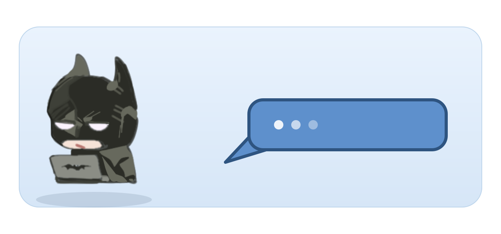

# dsh-bat-think

A Batman desktop pet for the DeepSeek Harness Web GUI. It lives in the
frame-wide `shell.overlay` seat: it floats above the conversation without
covering controls, and only its own pixels take pointer events.



## What it does

- **Idle:** Batman works at his laptop (`idle.png`) and breathes gently.
- **Thinking:** while an Agent is running it switches to the mouse-in-hand
  frame (`thinking.png`) and shows a bouncing three-dot thought bubble. Both
  revert when the run ends.
- **Clicks:** while idle it says one of the `sayings` (`阿尔弗雷德！` /
  `正在归档……` / `我要夜巡了`). While the Agent runs, a click hides the bubble
  and says `thinkingAck` (「稍等」); the bubble returns a few seconds later if
  the run is still going.
- **API usage:** click the laptop to open a small card with the current model,
  output / input / cache-read tokens, context occupancy, and a total across
  loaded sessions. Click the laptop again or `×` to close it.
- **Stickers:** the dice button in the hover toolbar puts a random accessory
  from `assets/accessories/` on the pet. Accessories share the artwork's
  512×512 canvas, so they land exactly where they were drawn, and they breathe,
  drag and scale with the pet. Clicking a sticker's pixels removes it.
- **Placement:** drag the pet anywhere (remembered); hover for `−` / `+` to
  resize (96–320 px) and `×` to tuck it into a small round chip.

## Install

From the DSH CLI:

```bash
dsh plugin --profile <your-profile> add dsh-bat-think
```

Or open **Plugins → Add plugin** in the GUI and give it `dsh-bat-think`, then
refresh the window (Ctrl+R). The pet appears in the bottom-right corner.

Requires a DSH release whose Web GUI has the `shell.overlay` slot (the
`@deepseek-ai/dsh-client-ui-layout` package). No build step: the bundle ships
plain ES modules and PNGs.

## Customize without code

Everything the pet shows comes from `assets/`:

| File | When it shows |
| --- | --- |
| `assets/idle.png` | normal |
| `assets/thinking.png` | while an Agent is running |
| `assets/accessories/*.png` | picked by the dice |

- Both frames should be transparent PNGs on the same canvas, with the character
  aligned, so switching does not jump.
- `assets/pet.json` holds the display name, default width (`size`), speech lines
  (`sayings`, `thinkingAck`), the accessory list, and the `canvas` contract:
  `{ "width": 512, "height": 512, "crop": [left, top, width, height] }` records
  which part of the 512×512 canvas the frames crop, which is what lets
  accessories land at their drawn position. If you replace the frames with an
  uncropped 512×512 image, set `crop` to `[0, 0, 512, 512]`.
- Drop a new PNG into `assets/accessories/` and restart DSH: the folder is
  scanned at runtime. Without a restart, add the filename to `accessories` in
  `pet.json`.

## Layout

- `index.js` — Host half: serves `assets/` at `/dsh-bat-think/*`, plus a live
  JSON listing of `assets/accessories/`.
- `client.js` — Client half: the `shell.overlay` entry, the pet component, the
  thought bubble, the usage card and the sticker layer.
- `cordis.patch.yml` — inserts the `dsh-bat-think` plugin row.

## Remove

Disable **Batman desktop pet** in Settings → Plugins, or remove the bundle. The
pet keeps only local UI state: `dsh-bat-think:position`, `:size`, `:collapsed`,
`:accessory` in `localStorage` and `:greeted` in `sessionStorage`.

## License

MIT for the code. The character art is fan art and is **not** covered by the
MIT license — see [NOTICE.md](NOTICE.md).
