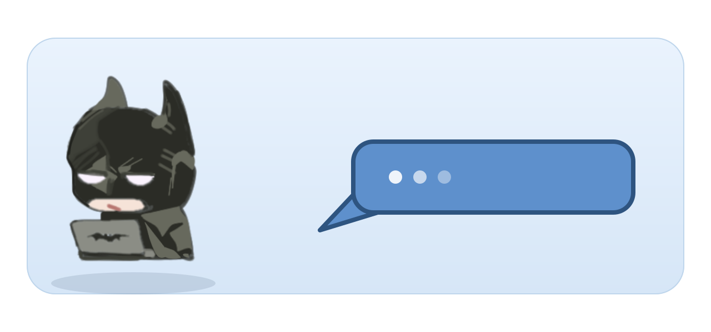

# dsh-bat-think

一只住在 DeepSeek Harness Web GUI 里的蝙蝠侠桌宠。它挂在整窗的 `shell.overlay` 层上，浮在对话区之上，只有自己身体范围会接收鼠标。



## 会做什么

- **日常**：敲电脑（`idle.png`），轻轻呼吸；
- **思考**：Agent 在跑（回复、调工具）时换成拿鼠标那张（`thinking.png`），头顶冒三点跳动的思考气泡，跑完自动变回；
- **点击**：空闲时随机说一句 `sayings`（阿尔弗雷德！/ 正在归档…… / 我要夜巡了）；思考时点击先收起气泡、改说「稍等」，几秒后还在跑就把气泡换回来；
- **API 用量**：点它脚边的电脑弹出小面板——当前模型、输出 / 输入 / 缓存读取 token、上下文占用，以及已加载会话的合计；再点电脑或点 `×` 关闭；
- **配件**：悬停工具栏里的骰子会从 `assets/accessories/` 随机戴一个贴纸。配件和立绘共用 512×512 画布，所以**按原坐标贴合**，并跟着立绘一起呼吸、拖动、缩放；点贴纸图案本身摘掉；
- **摆放**：拖动换位置（记住）；悬停 `−` / `+` 调大小（96–320 px），`×` 收成小圆头像。

## 安装

```bash
dsh plugin --profile <你的 profile> add dsh-bat-think
```

或在图形界面里 **插件 → 添加插件**，填 `dsh-bat-think`，然后刷新窗口（Ctrl+R）。宠物会出现在右下角。

要求宿主的 Web GUI 提供 `shell.overlay` 插槽（即装有 `@deepseek-ai/dsh-client-ui-layout`）。无需构建：包里就是普通 ES 模块和 PNG。

## 不改代码的定制

所有画面都来自 `assets/`：

| 文件 | 什么时候显示 |
| --- | --- |
| `assets/idle.png` | 平时 |
| `assets/thinking.png` | Agent 在跑时 |
| `assets/accessories/*.png` | 骰子随机挑 |

- 两张立绘用同一块画布、透明 PNG、角色对齐，切换才不会跳；
- `assets/pet.json` 里是名字、默认宽度（`size`）、台词（`sayings`、`thinkingAck`）、配件列表，以及 `canvas` 契约：`{ "width": 512, "height": 512, "crop": [左, 上, 宽, 高] }` 记录立绘是从 512×512 画布哪一块裁出来的——配件就是靠它对齐的。如果你换成不裁的 512×512 整图，把 `crop` 改成 `[0, 0, 512, 512]`；
- 新配件：PNG 丢进 `assets/accessories/`，重启 DSH 后会自动扫描；不想重启就在 `pet.json` 的 `accessories` 里加文件名。

## 结构

- `index.js` —— Host 半部分：把 `assets/` 挂到 `/dsh-bat-think/*`，并提供配件目录的实时 JSON 列表；
- `client.js` —— Client 半部分：`shell.overlay` 插槽、宠物组件、思考气泡、用量面板、贴纸层；
- `cordis.patch.yml` —— 插入 `dsh-bat-think` 插件行。

## 卸载

设置 → 插件 → 关掉「蝙蝠侠桌宠」，或移除 bundle。插件只在本地存了几个 UI 状态：`dsh-bat-think:position`、`:size`、`:collapsed`、`:accessory`（`localStorage`）和 `:greeted`（`sessionStorage`）。

## 许可

代码 MIT；角色立绘是饭制同人画，**不在 MIT 覆盖范围内**，见 [NOTICE.md](NOTICE.md)。
